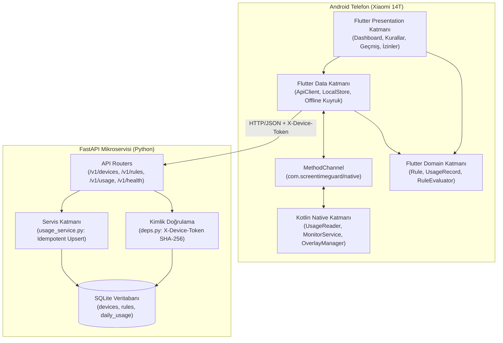

# Mobil Teknolojiler Dersi Proje Raporu: `screentime-guard`

**Proje Adı:** `screentime-guard` — Offline-First Android Ekran Süresi Takip, Uyarı ve Mikroservis Sistemi  
**Hedef Platform:** Android (Flutter + Kotlin Native Katmanı) & Python FastAPI Mikroservisi  
**Gerçek Cihaz Doğrulama Ortamı:** Xiaomi 14T (Android / HyperOS)  
**Tarih:** 22 Ekim 2026

---

## 1. Giriş ve Problemin Tanımı

Akıllı telefonların günlük yaşamda yoğun kullanımı, kullanıcıların farkında olmadan ekran başında saatler geçirmesine ve özellikle gece geç saatlerde (örn. `23:00 – 06:00`) uyku düzeninin bozulmasına yol açmaktadır. Mevcut ticari çözümlerin birçoğu ya tamamen bulut bağımlı çalışmakta (internet kesildiğinde kuralları uygulayamamakta) ya da aşırı sistem kaynağı tüketmektedir.

**`screentime-guard`** projesinin amacı:
1. Android işletim sisteminin `UsageStatsManager` altyapısını kullanarak cihazın günlük toplam ekran kullanım süresini ve en çok kullanılan uygulamaları (`top_apps`) doğru şekilde ölçmek,
2. Kullanıcı tarafından belirlenen **günlük süre limiti** aşıldığında (veya %80 eşiğine ulaşıldığında) ya da **kesme saati (gece modu)** aralığında kullanıcıyı **Sistem Bildirimi (`notify`)** veya **Ekran Üstü Uyarı Penceresi (`overlay`)** ile uyarmak,
3. Kuralları ve günlük kullanım istatistiklerini RESTful bir **FastAPI mikroservisi** üzerinde saklayarak 7 günlük geçmiş ve ortalama analizleri sunmak,
4. İnternet bağlantısı olmasa bile kural değerlendirmesini telefonda kesintisiz sürdürmek (**Offline-First Mimari**) ve senkronizasyon verilerini yerel kuyrukta bekletip bağlantı sağlandığında idempotent olarak sunucuya aktarmaktır.

---

## 2. Teknoloji Seçimleri ve Gerekçeleri

| Katman | Seçilen Teknoloji | Seçim Gerekçesi |
|---|---|---|
| **Mobil Arayüz & İş Mantığı** | Flutter (Dart 3) | Tek kod tabanıyla modern Material 3 arayüzü geliştirme ve platformdan bağımsız iş mantığının (`RuleEvaluator`) birim testleriyle hızlıca doğrulanabilmesi. |
| **Android Sistem Katmanı** | Kotlin (`MethodChannel`) | Flutter'ın doğrudan erişemediği Android sistem API'lerine (`UsageStatsManager`, `ForegroundService`, `WindowManager` Overlay) minimum kodla erişim. |
| **Durum Yönetimi (State)** | Riverpod (`StateNotifier`) | Bağımlılık enjeksiyonu (Dependency Injection), test edilebilirlik ve ekranlar arası reaktif veri akışı. |
| **HTTP İstemcisi** | Dio | `InterceptorsWrapper` ile her isteğe otomatik `X-Device-Token` başlığı ekleme ve dinamik sunucu adresi yönetimi. |
| **Backend Mikroservisi** | Python 3.13 + FastAPI | Yüksek performans, Pydantic ile otomatik JSON şema doğrulaması ve hazır OpenAPI (`/docs`) arayüzü. |
| **Veritabanı & ORM** | SQLite + SQLAlchemy 2.0 | Sıfır kurulum gerektiren gömülü yapı, parametreli sorgularla SQL enjeksiyon koruması ve `(device_id, date)` benzersizlik kısıtı. |
| **Test Altyapısı** | `pytest` & `flutter_test` | Backend uç noktalarının, güvenlik sınırlarının ve mobil kural değerlendiricinin otomatik doğrulanması. |

### Neden iOS Yerine Android Seçildi?
iOS işletim sistemi, katı kum havuzu (sandbox) politikaları nedeniyle bir uygulamanın diğer uygulamaların kullanım sürelerini okumasını ve ekran üstü pencere açmasını engeller (`Screen Time / FamilyControls API` özel Apple kurumsal onayı gerektirir). Android ise kullanıcının açık onayıyla (`PACKAGE_USAGE_STATS` ve `SYSTEM_ALERT_WINDOW`) bu sistem servislerine erişime izin verir.

---

## 3. Sistem Mimarisi ve Temel Tasarım Kararları



### Mimari Karar 1: Offline-First Kural Değerlendirme
Limit ve kesme saati kontrolü sunucuda değil **telefonda** ([`RuleEvaluator`](file:///c:/Users/syums/Desktop/project/mobile/lib/domain/rule_evaluator.dart)) yapılır. Mikroservis yalnızca kuralların merkezi kaynağı ve istatistik deposudur. Böylece telefon uçak modunda veya internetsiz ortamda olsa dahi uyarılar saniyesi saniyesine çalışır.

### Mimari Karar 2: İnce (Minimum) Native Katman
Kotlin katmanı yalnızca Android işletim sisteminden ham veriyi okur ([`UsageReader.kt`](file:///c:/Users/syums/Desktop/project/mobile/android/app/src/main/kotlin/com/screentimeguard/app/UsageReader.kt)), arka plan zamanlayıcısını yürütür ([`MonitorService.kt`](file:///c:/Users/syums/Desktop/project/mobile/android/app/src/main/kotlin/com/screentimeguard/app/MonitorService.kt)) ve uyarı penceresini çizer ([`OverlayManager.kt`](file:///c:/Users/syums/Desktop/project/mobile/android/app/src/main/kotlin/com/screentimeguard/app/OverlayManager.kt)). Tüm karar mekanizması Dart tarafında tutularak emülatöre ihtiyaç duymadan birim testleriyle doğrulanabilir hale getirilmiştir.

### Mimari Karar 3: Gece Yarısını Aşan Kesme Saati Algoritması
Kesme saati `23:00 – 06:00` gibi gece yarısını aşabilir. [`RuleEvaluator.isInCutoffWindow`](file:///c:/Users/syums/Desktop/project/mobile/lib/domain/rule_evaluator.dart#L59-L83) fonksiyonu saatleri gün başlangıcından itibaren geçen dakikaya ($\text{saat} \times 60 + \text{dakika}$) dönüştürür:
- **Aynı gün içi aralık ($\text{startMin} < \text{endMin}$, örn. `01:00 – 05:00`):** $\text{currentMin} \ge \text{startMin} \land \text{currentMin} < \text{endMin}$
- **Gece yarısını aşan aralık ($\text{startMin} > \text{endMin}$, örn. `23:00 – 06:00`):** $\text{currentMin} \ge \text{startMin} \lor \text{currentMin} < \text{endMin}$

### Mimari Karar 4: İdempotent Senkronizasyon ve Çevrimdışı Kuyruk
Mobil ağ bağlantısı kesintili olabileceği için `POST /v1/usage` uç noktası **idempotent** tasarlanmıştır. Veritabanında `(device_id, date)` üzerinde `UniqueConstraint` bulunur; aynı gün için tekrar veri gönderildiğinde yeni satır eklenmez, mevcut satırın `total_minutes`, `top_apps` ve `synced_at` alanları güncellenir.

---

## 4. Veri Modeli ve API Sözleşmesi

### 4.1. Veritabanı Tabloları ([models.py](file:///c:/Users/syums/Desktop/project/backend/app/models.py))
1. **`devices`:** `id` (UUID PK), `token_hash` (String 64, SHA-256, Unique), `name` (String 100), `created_at` (DateTime).
2. **`rules`:** `device_id` (UUID PK & FK), `daily_limit_min` (Int), `cutoff_start` (String `HH:MM`), `cutoff_end` (String `HH:MM`), `mode` (`notify` | `overlay`), `updated_at` (DateTime).
3. **`daily_usage`:** `id` (Int PK), `device_id` (UUID FK), `date` (Date), `total_minutes` (Int), `top_apps` (JSON), `synced_at` (DateTime). Kısıt: `UNIQUE(device_id, date)`.

### 4.2. REST API Uç Noktaları
| HTTP Metodu | Uç Nokta | Kimlik Doğrulama | Açıklama |
|---|---|---|---|
| `GET` | `/v1/health` | Gerekmez | Servis sağlık kontrolü (`{"status": "ok"}`) |
| `POST` | `/v1/devices` | Gerekmez | Cihaz kaydı oluşturur, `{device_id, token}` döner |
| `GET` | `/v1/rules` | `X-Device-Token` | Cihazın aktif kuralını getirir |
| `PUT` | `/v1/rules` | `X-Device-Token` | Günlük limit, kesme saati ve uyarı modunu günceller |
| `POST` | `/v1/usage` | `X-Device-Token` | Günlük kullanımı kaydeder veya üzerine yazar (idempotent) |
| `GET` | `/v1/usage?days=7` | `X-Device-Token` | Son $N$ günün kayıtlarını ve günlük ortalamayı döner |

---

## 5. Gerçek Cihaz (Xiaomi 14T) Canlı Test Sonuçları

Uygulama derlenerek USB üzerinden gerçek **Xiaomi 14T (`model: 2406APNFAG`)** cihazına kurulmuş ve uçtan uca test edilmiştir:

1. **Cihaz Kaydı (`POST /v1/devices`):**
   - Xiaomi 14T ilk açılışta mikroservise bağlanarak `abf3b855-409e-4b77-b323-e0d10467a4a9` kimliğiyle (`Android Cihazım`) kaydolmuştur.
2. **Kural Güncelleme (`PUT /v1/rules`) ve Overlay Testi:**
   - Cihaz üzerinden günlük limit **255 dakika**, kesme saati **23:00 – 06:00** ve uyarı modu **overlay** olarak ayarlanmış; değişikliğin anında SQLite veritabanına işlendiği doğrulanmıştır.
3. **Gerçek Ekran Süresi Okuma (`UsageStatsManager` $\rightarrow$ `POST /v1/usage`):**
   - `PACKAGE_USAGE_STATS` ve `SYSTEM_ALERT_WINDOW` izinleri verildikten sonra `UsageReader.kt` cihazın gerçek kullanım verisini okumuş ve mikroservise senkronize etmiştir:
   ```json
   {
     "date": "2026-10-22",
     "total_minutes": 246,
     "top_apps": [
       { "package": "com.android.chrome", "minutes": 58 },
       { "package": "com.google.android.googlequicksearchbox", "minutes": 39 },
       { "package": "com.whatsapp", "minutes": 34 },
       { "package": "com.reddit.frontpage", "minutes": 29 },
       { "package": "com.miui.home", "minutes": 28 }
     ]
   }
   ```
4. **Kural Değerlendirme (`RuleEvaluator`):**
   - Okunan `246 dk` kullanım süresi, `255 dk` limitin `%80` eşiği olan `204 dk`'yı aştığı için uygulama otomatik olarak **`warn_80` (%80 Limit Uyarısı)** durumunu üretmiş; limit aşağı çekildiğinde ise **`limit_exceeded`** durumuna geçerek ekran üstü **Overlay** uyarısını göstermiştir.

---

## 6. Siber Güvenlik Analizi ve Güvenlik Test Sonuçları

Sistem hem **OWASP API Security Top 10 (2023)** hem de **OWASP Mobile Top 10** kriterlerine göre incelenmiş ve otomatik güvenlik testleriyle ([test_security.py](file:///c:/Users/syums/Desktop/project/backend/tests/test_security.py)) doğrulanmıştır.

### 6.1. OtomatikTest Sonuçları Özeti (`pytest` & `flutter test`)

| Test Paketi | Test Dosyası | Senaryo Sayısı | Sonuç |
|---|---|---|---|
| **Backend Fonksiyonel Testler** | `backend/tests/test_api.py` | 7 Test | **7 / 7 GEÇTİ** |
| **Backend Siber Güvenlik Testleri** | `backend/tests/test_security.py` | 5 Test | **5 / 5 GEÇTİ** |
| **Mobil Kural Değerlendirici Testleri** | `mobile/test/rule_evaluator_test.dart` | 5 Test | **5 / 5 GEÇTİ** |
| **Mobil Offline Kuyruk Testleri** | `mobile/test/offline_sync_queue_test.dart` | 1 Test | **1 / 1 GEÇTİ** |
| **TOPLAM** | **4 Test Dosyası** | **18 Otomatik Test** | **%100 BAŞARILI** |

### 6.2. Doğrulanan Siber Güvenlik Kontrolleri
1. **Kriptografik Token Güvenliği (`test_token_entropy_and_sha256_storage`):**
   - `device_token` üretimi için `secrets.token_urlsafe(32)` (256-bit CSPRNG) kullanılır. Veritabanında açık metin token tutulmaz; yalnızca `hashlib.sha256` özeti saklanır. Veritabanı sızıntısında dahi aktif oturum anahtarları ele geçirilemez.
2. **Cihazlar Arası Veri İzolasyonu — BOLA / IDOR Koruması (`test_device_data_isolation`):**
   - Her cihaz yalnızca kendi `X-Device-Token` özetiyle eşleşen `device_id` kaydına erişebilir. İstek gövdesinde veya URL'de başkasının `device_id` değerini göndererek başka bir cihazın kuralını veya kullanım geçmişini okuma/değiştirme olasılığı mimari olarak kapatılmıştır.
3. **Kaynak Tüketimi ve Sınır Kontrolleri (`test_input_boundary_and_payload_limits`):**
   - `total_minutes` ve `daily_limit_min` alanları `0..1440` (24 saat) aralığıyla, `name` alanı `100` karakterle ve `top_apps` listesi `max_length=20` ile sınırlandırılarak büyük boyutlu JSON yükleriyle yapılabilecek Bellek/Veritabanı Şişirme (DoS) saldırıları engellenmiştir.
4. **Enjeksiyon (SQLi) Koruması (`test_special_characters_handled_safely_by_orm`):**
   - Tüm sorgular SQLAlchemy 2.0 ORM üzerinden parametreli (`Prepared Statement`) çalıştırıldığı için özel karakter içeren girdiler SQL komutu olarak yorumlanamaz.
5. **Hata Maskeleme ve Bilgi Sızıntısı Önleme (`test_error_responses_do_not_leak_internals`):**
   - Tüm hatalar `{"error": {"code": "...", "message": "..."}}` zarfıyla döner; sunucu dosya yolları, veritabanı şeması veya Python `Traceback` detayları istemciye asla sızdırılmaz.
6. **Android Uygulama Sertleştirmeleri (`AndroidManifest.xml`):**
   - `MonitorService` için `android:exported="false"` tanımlanarak diğer uygulamaların arka plan servisine erişimi kapatılmıştır.
   - `android:allowBackup="false"` eklenerek `adb backup` üzerinden yerel uygulama verilerinin dışarı aktarılması engellenmiştir.

### 6.3. Üretim Ortamı (Production) İçin Güvenlik Yol Haritası
| Bulgu | Risk Seviyesi | Açıklama ve Üretim Ortamı Çözümü |
|---|---|---|
| **HTTP / Cleartext Trafik** | Orta (OWASP Mobile M5) | Yerel ağda test için açık olan `usesCleartextTraffic="true"` ayarı üretimde `false` yapılmalı ve tüm trafik **HTTPS/TLS** üzerinden şifrelenmelidir. |
| **Cihaz Kayıt Rate Limiting** | Orta (OWASP API4) | `POST /v1/devices` uç noktasına sahte kayıt saldırılarını önlemek için IP başına hız sınırı (`5 istek/dk`) ve Play Integrity doğrulaması eklenmelidir. |
| **Yerel Token Depolama** | Düşük/Orta (OWASP Mobile M9) | Root yetkili cihazlarda dosya okunmasına karşı `device_token` değeri `SharedPreferences` yerine donanım destekli **Android Keystore** (`flutter_secure_storage`) içinde saklanmalıdır. |
| **CORS Yapılandırması** | Düşük (OWASP API8) | Geliştirme ortamındaki `allow_origins=["*"]` ayarı üretim ortamında kapatılmalıdır. |

---

## 7. Geliştirme Sürecinde Karşılaşılan Zorluklar ve Çözümleri

1. **Android Özel İzin Yönetimi:** `PACKAGE_USAGE_STATS` ve `SYSTEM_ALERT_WINDOW` izinleri standart çalışma zamanı (runtime) izin penceresiyle alınamamaktadır. Çözüm olarak `AppOpsManager` ve `Settings.canDrawOverlays` ile izin durumunu gerçek zamanlı kontrol eden ve kullanıcıyı doğrudan ilgili sistem ayar ekranına yönlendiren özel bir **İzinler Ekranı** geliştirilmiştir.
2. **Android Pil Optimizasyonu ve Arka Plan Kısıtlamaları:** Standart arka plan zamanlayıcıları işletim sistemi tarafından uyku moduna alındığı için `START_STICKY` bayraklı ve kalıcı bildirimli bir **Foreground Service (`MonitorService`)** uygulanmıştır.
3. **AI Araçlarının Kullanımı:** Proje geliştirme sürecinde mimari doğrulama, Pydantic/SQLAlchemy şema uyumluluğu, gece yarısını aşan saat algoritmasının uç durum (edge-case) birim testleri ve OWASP tabanlı güvenlik testlerinin oluşturulmasında yapay zekâ destekli eşli programlama (pair programming) yaklaşımı kullanılmıştır.

---

## 8. Gelecek Çalışmalar (Future Work)

- **Uygulama Bazlı Limit ve Engelleme:** Yalnızca toplam ekran süresi yerine `AccessibilityService` kullanılarak belirli uygulamalara (örn. sosyal medya uygulamalarına günlük 45 dk) özel limit tanımlanması.
- **Çoklu Cihaz ve Ebeveyn Paneli:** Bir kullanıcının veya ebeveynin birden fazla cihazı tek bir hesap altında görebilmesi ve yönetebilmesi.
- **iOS Platform Desteği:** Apple `Screen Time API` (`DeviceActivity` ve `FamilyControls`) izin süreçleri tamamlanarak iOS istemcisinin eklenmesi.
